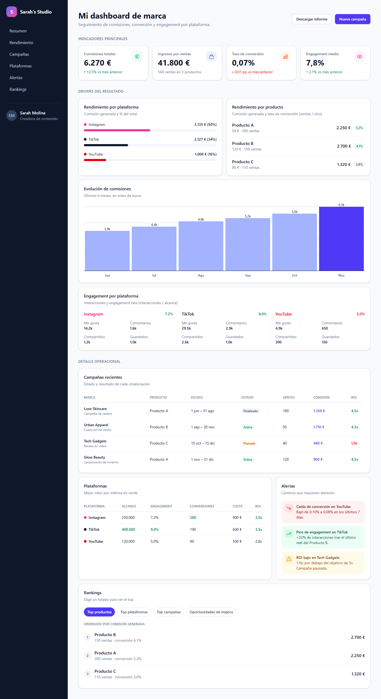
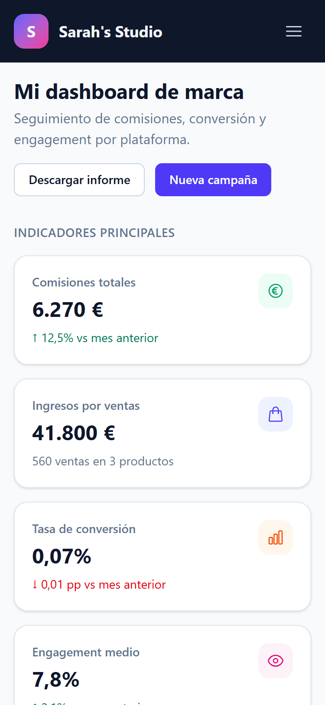

# Dashboard de influencer

Dashboard responsive para que una influencer consolide en un solo panel sus ventas, comisiones, conversión y engagement en Instagram, TikTok y YouTube. Los datos son de ejemplo.





## Qué muestra

| Bloque | Contenido |
|--------|-----------|
| KPIs | Comisiones totales, ingresos por ventas, tasa de conversión, engagement medio |
| Drivers | Rendimiento por plataforma y por producto, evolución mensual de comisiones, engagement por plataforma |
| Detalle operacional | Tabla de campañas, tabla de plataformas, alertas y rankings filtrables |

Contexto del negocio: 3 productos (A: 50 €, B: 120 €, C: 80 €) con una comisión del 15% por venta.

## Tecnologías

- HTML semántico.
- [Tailwind CSS v4](https://tailwindcss.com) por CDN (`@tailwindcss/browser@4`).
- [Charts.css](https://chartscss.org) 1.2.0 para el gráfico.
- Sin JavaScript propio ni CSS personalizado.

## Cómo verlo

Abre `index.html` en el navegador, o levanta el servidor local:

```bash
uv run --with flask server.py
```

y entra en http://localhost:3000.

## Decisiones técnicas

- **Mobile-first desde 320 px**, sin scroll horizontal en ningún ancho.
- **Menú hamburguesa sin JS:** checkbox `sr-only` + `<label>` y `group-has-checked:block`. Los enlaces llevan a cada sección.
- **Tablas responsivas:** por debajo de `md` cada fila se muestra como tarjeta (`before:content-[attr(data-label)]`); desde `md`, tabla normal.
- **Rankings filtrables sin JS:** radio buttons con estilo de pestaña y `group-has-[#id:checked]:block`.
- **Charts.css + Tailwind v4:** Charts.css no usa `@layer` y sus reglas ganan a las utilidades de Tailwind. El alto se controla con su variable `--aspect-ratio`.
- **Accesibilidad:** contraste WCAG AA en reposo y en hover, foco visible y HTML válido en el validador W3C.

## Estructura

```
index.html              dashboard
docs/layout-plan.md     plan de layout, componentes y datos de ejemplo
docs/reference/         diseño de referencia
docs/screenshots/       capturas del README
server.py               servidor local de la plantilla
```

---

Basado en la plantilla [html-hello](https://github.com/4GeeksAcademy/html-hello) de 4Geeks Academy.
